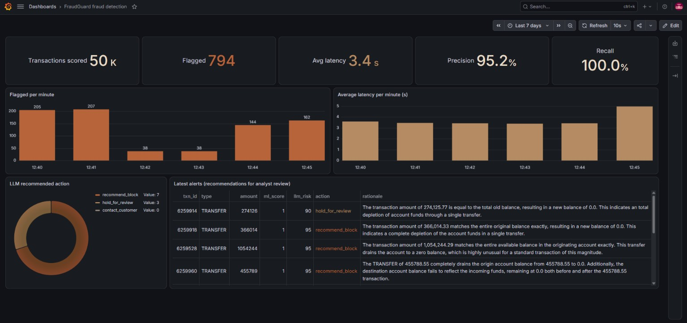
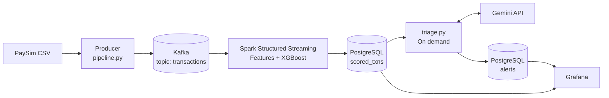

# Real-Time Fraud Detection Pipeline with LLM Alert Triage

A streaming pipeline that scores payment transactions in real time, flags suspicious ones, and uses an LLM to generate a short rationale, risk score and recommended action for an analyst to review. Built using simulated PaySim transaction data.



## What It Does

1. **Ingest:** A Python producer replays PaySim transactions into a Kafka topic at approximately 200 events per second.
2. **Score:** Spark Structured Streaming reads the topic in 5-second micro-batches, builds seven balance-based features and scores each transaction using an XGBoost classifier.
3. **Store:** Every scored transaction is written to PostgreSQL. Writes are idempotent using a primary key on `txn_id`, preventing duplicates during replays and restarts.
4. **Triage:** On demand, `triage.py` sends flagged transactions (raw fields only, not the ML score or label) to the Gemini API. It returns a risk score from 0 to 100, a two-sentence rationale and a recommended action.
5. **Monitor:** Grafana reads both PostgreSQL tables and refreshes every 10 seconds.

The LLM only explains and recommends. Nothing is blocked automatically. A human analyst makes the final decision.

## Architecture



## Results

Measured on the simulated PaySim dataset.

| Evaluation | Result |
|---|---|
| Offline test (time-based split, `step > 600`) | PR-AUC ≈ 1.00 |
| Offline precision | 94.8% |
| Offline recall | 100% |
| Fraud cases caught | 1,600 |
| Fraud cases missed | 0 |
| False positives | 88 |
| Rule baseline precision | 4.0% |
| Rule baseline recall | 96.6% |
| Live transactions scored | 50,000 |
| Live fraud cases | 756 (1.5%) |
| Live transactions flagged | 794 |
| Live precision | 95.2% |
| Live recall | 100% |
| Live false positives | 38 |
| Average end-to-end latency | 3.4 seconds |
| Throughput | Approximately 200 events/second |
| Replay test | No duplicate rows after replaying the same 50,000 transactions |

The 3.4-second latency includes the 5-second micro-batch trigger. Throughput is limited by the producer setting, not by a measured maximum Spark capacity.

## Technology Stack

| Technology | Purpose |
|---|---|
| Python | Producer, feature engineering and orchestration |
| PaySim | Simulated financial transaction dataset |
| Apache Kafka (KRaft mode) | Transaction message streaming |
| Apache Spark Structured Streaming (PySpark) | Micro-batch stream processing |
| XGBoost | Fraud classification |
| PostgreSQL 16 | Storage for scored transactions and alerts |
| Gemini API | AI-generated explanations and recommended actions |
| Grafana | Monitoring and visualization |
| Docker Compose | Running Kafka, PostgreSQL and Grafana |

## Repository Files

| File | Purpose |
|---|---|
| `docker-compose.yml` | Kafka, PostgreSQL and Grafana services |
| `pipeline.py` | `produce` sends transactions to Kafka; `consume` prints messages for debugging |
| `stream.py` | `train` trains the model and saves `model.pkl` and `results.png`; `run` starts streaming |
| `triage.py` | Gemini LLM triage of flagged transactions into the `alerts` table |
| `model.pkl` | Trained XGBoost model |
| `paysim.csv` | PaySim transaction dataset |
| `results.png` | Model evaluation visualizations |
| `fraud_dashboard.json` | Grafana dashboard configuration |
| `dashboard.png` | Grafana dashboard screenshot |

## How to Run

### Requirements

- Docker Desktop
- Python 3.10+
- Java 17+
- A free Gemini API key
- On Windows, Spark also needs `winutils.exe` in `C:\hadoop\bin`. The `stream.py` file sets `HADOOP_HOME` for it.
- On Linux or macOS, remove the three Windows-specific environment lines near the top of `stream.py`.

### 1. Install Python dependencies

```bash
pip install "pandas<3" pyspark xgboost scikit-learn sqlalchemy psycopg2-binary confluent-kafka matplotlib joblib openai requests
```

### 2. Download the dataset

Download PaySim from Kaggle:

https://www.kaggle.com/datasets/ealaxi/paysim1

Save the dataset as `paysim.csv` in the project folder.

### 3. Start Docker services

```bash
docker compose up -d
docker compose ps
```

This starts Kafka, PostgreSQL and Grafana.

### 4. Train the model

```bash
python stream.py train
```

This trains the XGBoost model and saves `model.pkl` and `results.png`.

If a trained `model.pkl` is already available, training does not need to be repeated.

### 5. Start Spark streaming

Open Terminal 1:

```bash
python stream.py run
```

Start Spark before the producer so that the streaming consumer is ready to receive new messages.

### 6. Start the transaction producer

Open Terminal 2:

```bash
python pipeline.py produce
```

The producer replays transactions into Kafka.

### 7. Configure Gemini API key and run triage

After the producer finishes, open PowerShell and set your Gemini API key:

```powershell
$env:GEMINI_API_KEY="YOUR_GEMINI_API_KEY"
```

Then run:

```powershell
python triage.py
```

The triage script retrieves flagged transactions that have not already been processed into the alerts table and sends selected raw transaction fields to Gemini.


### 8. Open Grafana

Visit: http://localhost:3000

**Default local development login credentials:**

| Field | Value |
|---|---|
| Username | `` |
| Password | `` |

These are default development credentials and should be changed for any publicly exposed deployment.

**Configure PostgreSQL as a Grafana data source:**

| Setting | Value |
|---|---|
| Host | `postgres:5432` |
| Database | `fraud` |
| Username | `fraud` |
| Password | `fraud` |
| TLS/SSL Mode | Disabled |

Then navigate to:

**Dashboards → New → Import**

Upload `fraud_dashboard.json` to import the fraud detection dashboard.

The dashboard reads data from both PostgreSQL tables:
- `scored_txns` – ML-scored transactions.
- `alerts` – Gemini-generated fraud explanations and recommendations.


## Design Decisions

- **Time-based split:** The model trains on `step <= 600`, while the stream replays only later transactions.
- **No label leakage:** `isFraud` is retained in the stream only to measure live precision and recall. It is not a model feature and is never sent to the LLM.
- **LLM sees raw fields only:** The ML score is hidden from the Gemini prompt, so the rationale is a second opinion rather than a restatement of the classifier.
- **Idempotent sink:** PostgreSQL uses `INSERT ... ON CONFLICT DO NOTHING` on `txn_id`, along with a Spark checkpoint.
- **Human in the loop:** Actions are labelled `recommend_block`, `hold_for_review` and `contact_customer`. They are recommendations, not automatic transaction blocks.

## Limitations

- PaySim is simulated data. Its fraud follows a relatively simple pattern, often involving an emptied origin account. Near-perfect scores will not necessarily generalize to real transaction traffic.
- Feature engineering and XGBoost scoring run in pandas inside each micro-batch using `toPandas()`. Spark handles ingestion and batching, but the ML scoring is not distributed.
- Throughput was not stress-tested because the producer rate is capped at approximately 200 events per second.
- The LLM may produce unsupported explanations with confidence. Only a small sample of flagged transactions was triaged, and its output requires analyst review.
- LLM triage runs on demand, not inside the real-time stream.
- All components run on one machine using single-node Docker services.

## Future Work

- Distributed scoring using a pandas UDF.
- A fraud-label feed that arrives after the transaction.
- Data and model drift monitoring.
- Scheduling LLM triage with Apache Airflow.

## Author

**Sayam Stuti Shuvadarsini**  


[LinkedIn](https://www.linkedin.com/in/sayam-stuti-shuvadarsini) | [GitHub](https://github.com/sayamstuti)

